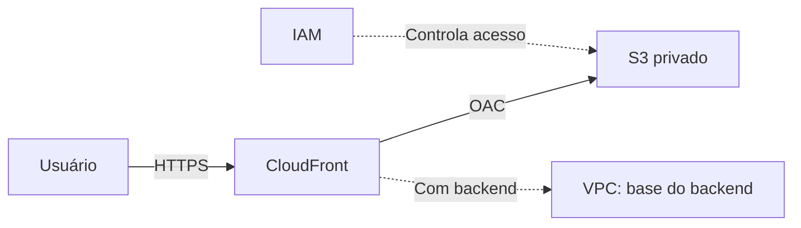

# workshop-22-10-26


Material adicional para o workshop do bootcamp _AWS AI FDE for Commerce_ de 22/10/2026: **Hospedagem Estática + Introdução a VPC (Teoria e Prática)**.

Faz parte da **Sprint 1: AWS para commerce, serviços core e serverless** da Formação _AWS AI FDE for Commerce_ (AI/R Fellowship 2026) e complementa a **Semana 1** da trilha de estudos [AI/R no Udemy](https://aircompany.udemy.com/learning-paths/12612441/): IAM, S3, CloudFront e VPC. A Semana 2 (serviços serverless, como Lambda, DynamoDB e API Gateway) fica fora deste material. O acesso à trilha é pelo login do Udemy da AI/R.

Este repositório entrega uma **skill** para o seu agente de IA: depois de instalada, ele passa a atuar como um tutor do que foi visto no workshop, explicando os conceitos com analogias, guiando a prática numa conta de estudo e conferindo se você entendeu.

## 🎯 O que vimos no workshop

O objetivo foi entender as peças primordiais de um **site estático na AWS** e vê-lo no ar.



| Tópico         | Em uma frase                                                                                      |
| -------------- | ------------------------------------------------------------------------------------------------- |
| **IAM**        | Define **quem** pode fazer **o quê**: root, users, groups, roles e policies.                      |
| **S3**         | Guarda os arquivos do site em um bucket **privado**, com classes, versioning e segurança.         |
| **CloudFront** | CDN que entrega o conteúdo rápido e seguro, e é a **única porta de entrada** do bucket (via OAC). |
| **VPC**        | Sua rede privada na AWS: a base de todo o backend que vem depois do site estático.                |
| **Demo**       | O site estático no ar: S3 privado + CloudFront com OAC.                                           |

> O site estático **não roda dentro de uma VPC**. Ela entra quando o e-commerce ganha backend, API ou banco.

## 🌐 Demo no Ar

A demo do workshop, um site estático servido por **S3 privado + CloudFront**, está no ar:

**https://dhdwvoyc20mo5.cloudfront.net/**

Use-a para ver na prática o que foi explicado (no Windows, use `curl.exe` no PowerShell):

| O que observar              | Como ver                                        | O que esperar                                                                                                                                                                                             |
| --------------------------- | ----------------------------------------------- | --------------------------------------------------------------------------------------------------------------------------------------------------------------------------------------------------------- |
| HTTPS pelo CloudFront       | Abra a URL no navegador                         | O site carrega em HTTPS, em um domínio `*.cloudfront.net`                                                                                                                                                 |
| Redirecionamento para HTTPS | `curl -I http://dhdwvoyc20mo5.cloudfront.net/`  | `301` com `Location: https://...` e `X-Cache: Redirect from cloudfront`                                                                                                                                   |
| Cache na edge               | `curl -I https://dhdwvoyc20mo5.cloudfront.net/` | `X-Cache: Hit from cloudfront` (ou `Miss from cloudfront` se o objeto ainda não estava no cache, ou `RefreshHit from cloudfront` se o cache expirou e foi revalidado na origem) e `Via: ... (CloudFront)` |
| Edge location que respondeu | Mesmo comando, cabeçalho `X-Amz-Cf-Pop`         | Um código de ponto de presença, como `IAD...` ou `MIA...` (varia conforme a sua localização)                                                                                                              |
| S3 como origem              | Mesmo comando, cabeçalho `Server`               | `Server: AmazonS3`                                                                                                                                                                                        |

A demo é do workshop e pode ser desativada depois. Para montar a sua na conta de estudo, peça ao agente: _"Me guia no passo a passo de servir um site com S3 privado + CloudFront usando OAC."_

## 📦 Este Repositório

Contém a skill `workshop-22-10-26`, no formato de _Agent Skills_ (um `SKILL.md` com instruções para o agente e arquivos de apoio):

- **Tutor em nível básico:** começa pela analogia (prédio, condomínio, filiais) e só depois traz a definição.
- **Prática guiada:** roteiros passo a passo para uma **conta de estudo**, sempre terminando com a limpeza dos recursos.
- **Confere o entendimento:** faz perguntas de autoavaliação e corrige explicando o porquê.
- **Seguro por padrão:** não pede nem repete credenciais, defende menor privilégio e avisa sobre custos antes de criar recursos.
- **Sem inventar:** os fatos vêm dos `topics/` e da documentação oficial da AWS; preço e limites ele manda conferir nas páginas oficiais.

> O `SKILL.md` e os `topics/` estão **em inglês**, mas o agente responde no idioma em que você escrever.

## 🗂️ Estrutura do Repositório

```text
workshop-22-10-26/
├── LICENSE
├── README.md
└── skills/
    └── workshop-22-10-26/
        ├── SKILL.md          # instruções do tutor (carregado pelo agente)
        └── topics/
            ├── iam.md
            ├── s3.md
            ├── cloudfront.md
            └── vpc.md
```

### **/skills/workshop-22-10-26**

A skill em si. O nome da pasta é igual ao `name` do `SKILL.md`, como exigem os agentes.

### **/skills/workshop-22-10-26/topics**

Material de estudo por tópico. Cada arquivo tem analogia, conceitos, armadilhas comuns, roteiro de prática, perguntas de autoavaliação e links para a documentação oficial da AWS.

| Arquivo         | Conteúdo                                                               | Quando ler    |
| --------------- | ---------------------------------------------------------------------- | ------------- |
| `iam.md`        | Root, user, group, role, policy JSON, menor privilégio                 | Primeiro      |
| `s3.md`         | Buckets, objetos, storage classes, versioning, segurança, S3 como site | Depois do IAM |
| `cloudfront.md` | CDN, cache/TTL, invalidation, OAC, HTTPS e domínio próprio             | Depois do S3  |
| `vpc.md`        | CIDR, subnets públicas/privadas, IGW, NAT, Security Group vs NACL      | Por último    |

## 🚀 Instalando a Skill

### Pré-requisitos

- [Git](https://git-scm.com/install/);
- Um agente de IA com suporte a skills, como o [OpenCode](https://opencode.ai/download) (veja a tabela de outros agentes mais abaixo).

### 1. Clone o repositório

```bash
git clone https://github.com/leostacowskicompasso/workshop-22-10-26.git
cd workshop-22-10-26
```

### 2. Copie a skill para o seu agente (OpenCode)

**Global** (vale para qualquer projeto), em macOS/Linux/Git Bash:

```bash
mkdir -p ~/.config/opencode/skills
cp -r skills/workshop-22-10-26 ~/.config/opencode/skills/
```

**Global**, em PowerShell (Windows):

```powershell
New-Item -ItemType Directory -Force "$HOME\.config\opencode\skills" | Out-Null
Copy-Item -Recurse skills\workshop-22-10-26 "$HOME\.config\opencode\skills\"
```

**Só em um projeto:** copie a pasta para `.opencode/skills/` na raiz do projeto, ficando `.opencode/skills/workshop-22-10-26/SKILL.md`.

### 3. Reinicie o agente e confira

Feche e abra o OpenCode de novo. Para conferir, peça:

```text
Carregue a skill workshop-22-10-26 e me diga o que ela cobre.
```

Se ela não aparecer, confira se o arquivo se chama `SKILL.md` (em maiúsculas), se o nome da pasta é igual ao `name` do frontmatter e se você reiniciou o agente. Mais detalhes em [Troubleshoot loading](https://opencode.ai/docs/skills/#troubleshoot-loading).

### Usando outro agente

O formato _Agent Skills_ é o mesmo: basta copiar a pasta `workshop-22-10-26` para o local de skills do seu agente.

| Agente      | Skills globais               | Skills do projeto   |
| ----------- | ---------------------------- | ------------------- |
| OpenCode    | `~/.config/opencode/skills/` | `.opencode/skills/` |
| Claude Code | `~/.claude/skills/`          | `.claude/skills/`   |
| Codex       | `~/.codex/skills/`           | `.agents/skills/`   |
| Cursor      | `~/.cursor/skills/`          | `.cursor/skills/`   |
| Kiro        | `~/.kiro/skills/`            | `.kiro/skills/`     |

Fontes: [OpenCode Agent Skills](https://opencode.ai/docs/skills/) e o [README de skills do Agent Toolkit for AWS](https://github.com/aws/agent-toolkit-for-aws/tree/main/skills). O OpenCode também lê os caminhos compatíveis `~/.claude/skills/` e `~/.agents/skills/`.

## 💬 Prompts de Exemplo

Alguns exemplos para conversar com o agente depois de instalar a skill:

### IAM

```text
Me explica a diferença entre IAM user e role usando uma analogia.
```

```text
Por que eu não devo usar o usuário root no dia a dia?
```

### S3

```text
Por que o nome de um bucket precisa ser único?
```

```text
Como o versioning me ajuda a recuperar um arquivo que foi apagado?
```

### CloudFront

```text
Me guia no passo a passo de servir um site com S3 privado + CloudFront usando OAC.
```

```text
Atualizei o site e o CloudFront continua mostrando a versão antiga. O que pode ser?
```

### VPC

```text
Quando uma subnet é pública? Explica com a analogia do condomínio.
```

```text
Security Group ou NACL: quando eu uso cada um?
```

### Prática e revisão

```text
Quero praticar o site estático na minha conta de estudo. Me guie e me lembre de limpar tudo no final.
```

```text
Me faz 3 perguntas para eu conferir se entendi o CloudFront.
```

## 🧭 Trilha de Estudo Sugerida

Siga esta ordem junto com a **Semana 1** da [trilha do Udemy](https://aircompany.udemy.com/learning-paths/12612441/), que usa o curso _Ultimate AWS Certified Developer Associate 2026 DVA-C02_. A trilha pede para assistir **apenas às seções indicadas**:

| #   | Tópico         | Seções do curso (Semana 1)                         | Prática                                                                      |
| --- | -------------- | -------------------------------------------------- | ---------------------------------------------------------------------------- |
| 1   | **IAM**        | _IAM & AWS CLI_ · _IAM Roles & Policies_           | Grupo com leitura no S3, usuário e uma role para o Lambda                    |
| 2   | **S3**         | _S3 Introduction_ · _Advanced S3_ · _S3 Security_  | Bucket **privado**, envio do site e o `Access Denied` do acesso direto       |
| 3   | **CloudFront** | _CloudFront_                                       | Distribution na frente do bucket com OAC, com teste de cache e invalidation  |
| 4   | **VPC**        | _VPC Fundamentals_                                 | VPC com 2 AZs (sem NAT Gateway, para evitar custo) e route tables pública vs privada |

Para fechar a semana, a trilha indica a leitura gratuita do [AWS Well-Architected Framework](https://aws.amazon.com/architecture/well-architected/) (6 pilares, cerca de 1h).

Cada arquivo de `topics/` tem a seção _Hands-on practice_ com os passos.

## ⚠️ Segurança e Custos

- Use **sempre uma conta de estudo**. Nunca pratique em conta de produção ou da empresa.
- **Nunca cole access keys, secrets ou senhas** no chat com o agente. Prefira roles e credenciais temporárias.
- Ative **MFA** no usuário root e não o use no dia a dia.
- Alguns recursos geram custo (por exemplo NAT Gateway e IPv4 público). O Free Tier de contas novas é baseado em créditos: confira os termos atuais em [AWS Free Tier](https://aws.amazon.com/free/).
- Ao terminar qualquer prática, **apague os recursos**: desabilite e apague a distribution, esvazie e apague o bucket, e remova a VPC e qualquer NAT Gateway.

## 📚 Referências

- [Trilha AI/R no Udemy](https://aircompany.udemy.com/learning-paths/12612441/)
- [Demo do workshop no ar](https://dhdwvoyc20mo5.cloudfront.net/)

- [AWS IAM](https://aws.amazon.com/iam) · [Documentação do IAM](https://docs.aws.amazon.com/IAM/latest/UserGuide/introduction.html)
- [Amazon S3](https://aws.amazon.com/s3/) · [Documentação do S3](https://docs.aws.amazon.com/AmazonS3/latest/userguide/Welcome.html)
- [Amazon CloudFront](https://aws.amazon.com/cloudfront/) · [Documentação do CloudFront](https://docs.aws.amazon.com/AmazonCloudFront/latest/DeveloperGuide/Introduction.html)
- [Amazon VPC](https://aws.amazon.com/vpc/) · [Documentação da VPC](https://docs.aws.amazon.com/vpc/latest/userguide/what-is-amazon-vpc.html)
- [AWS Reference Architecture Diagrams](https://docs.aws.amazon.com/reference-architecture-diagrams/)
- [AWS Well-Architected Framework](https://aws.amazon.com/architecture/well-architected/)
- [Agent Toolkit for AWS: agent skills](https://github.com/aws/agent-toolkit-for-aws/tree/main/skills): skills oficiais para tarefas mais específicas na AWS, além do básico deste workshop.

## 📄 Licença

Este projeto é de domínio público, sob a licença [Unlicense](./LICENSE).
